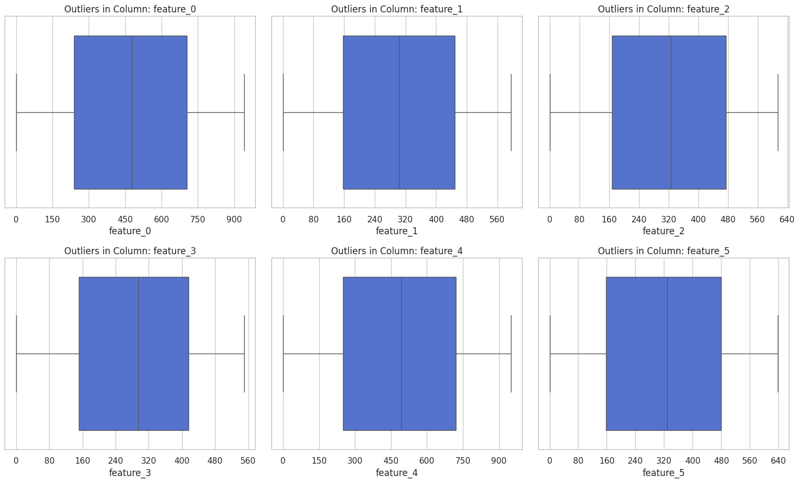
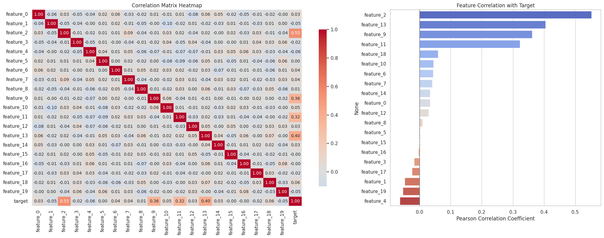
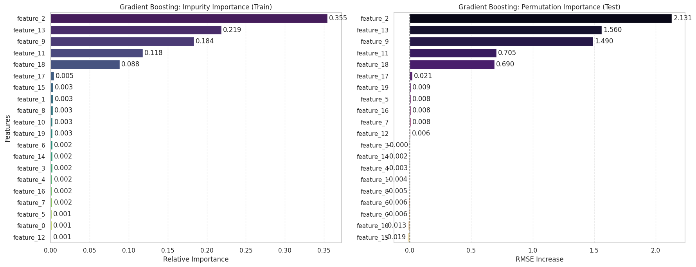
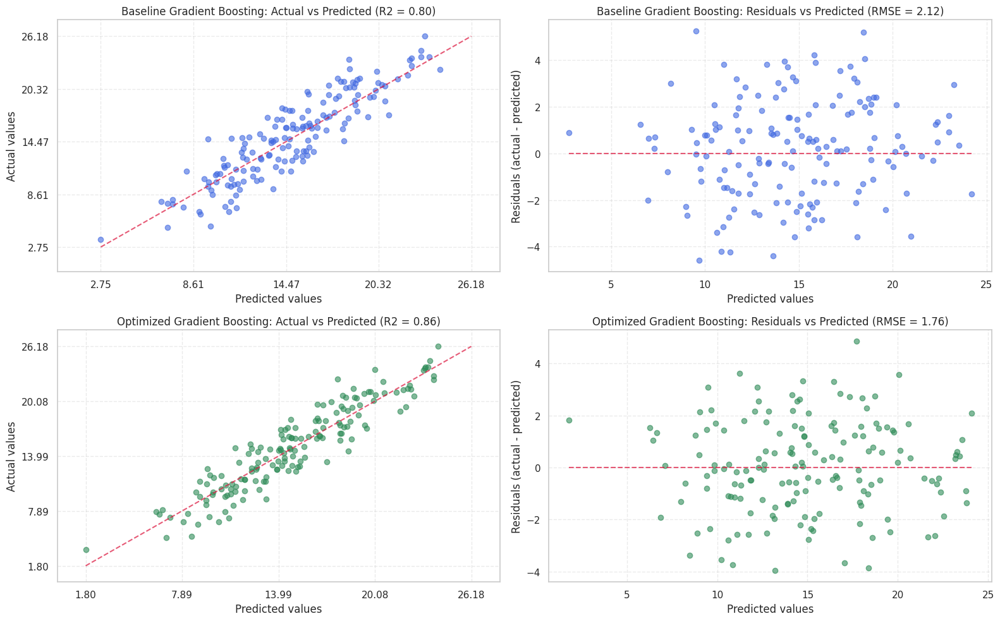

<p align="center">
  <picture>
    <source media="(prefers-color-scheme: dark)" srcset="docs/assets/gauss-logo-dark.png">
    <source media="(prefers-color-scheme: light)" srcset="docs/assets/gauss-logo-light.png">
    
  </picture>
</p>

<p align="center">
  
  
  
  
  
  
</p>

GAUSS is a regression model for a 20-feature tabular dataset, together with what it takes to retrain it and serve it. It covers three things: how the model is trained, how someone gets predictions from it, and how it keeps working when new data arrives.

The repository covers the whole path. An MLflow server tracks every run and holds the model registry, a one-shot job trains the first model, a FastAPI service returns single and bulk predictions, and a promotion gate decides whether a retrained model replaces the one in use. Everything starts with one Docker Compose command.

> The exploration notebook in `notebooks/` is written in Spanish. Only the training data is committed, so bring your own unlabelled CSV for bulk predictions.

## Results

These are the numbers for the model currently in use, measured on 160 rows it never saw while it was being tuned.

| Metric | Value |
|---|---|
| RMSE | 1.73 |
| MAE | 1.40 |
| R² | 0.87 |
| MAPE | 11% |
| Predictions within 2 units of the real value | 75% |

The target goes from about 0.3 to 27 with an average near 15, so being off by 1.4 on average is roughly a tenth of a typical value. Always predicting the average would give an RMSE of 4.76, and the grid search in the notebook reached 1.76.

## Endpoints

The API listens on http://127.0.0.1:8000 and has interactive docs at `/docs`.

| Method | Path | What it does |
|---|---|---|
| GET | `/health` | Says which model version is being served and which features it expects |
| POST | `/predict` | Takes one row as JSON and returns one prediction |
| POST | `/predict-batch` | Takes a CSV file and returns a CSV with one prediction per row |

`GET /health`

```bash
curl http://127.0.0.1:8000/health
```

```json
{
  "status": "healthy",
  "model_name": "gradient-boosting-regressor",
  "model_version": "1",
  "required_features": ["feature_2", "feature_13", "feature_9", "feature_11", "feature_18"]
}
```

`POST /predict`

```bash
curl -X POST http://127.0.0.1:8000/predict \
  -H "Content-Type: application/json" \
  -d '{"feature_2": 300, "feature_13": 150, "feature_9": 50, "feature_11": 3.5, "feature_18": 25}'
```

```json
{"target_pred": 11.780905105483964}
```

`POST /predict-batch`

```bash
head -4 data/raw/train.csv > sample.csv
curl -F "file=@sample.csv" http://127.0.0.1:8000/predict-batch
```

```
target_pred
13.84245048188129
20.123989926119258
14.410932888243398
```

The file can keep all its columns, since only the five the model uses are read, and the predictions come back in the same order as the rows.

A missing or non-numeric field in `/predict` returns 422. `/predict-batch` returns 400 if the file name doesn't end in `.csv` and 422 if one of the five columns is missing.

## Where to look in MLflow

Everything the API and the training jobs do ends up in the MLflow UI at http://127.0.0.1:5001. These are the pages worth opening:

| To see | Open |
|---|---|
| Every training and every CSV upload | http://127.0.0.1:5001/#/experiments/1/runs |
| Only the CSV uploads | http://127.0.0.1:5001/#/experiments/1/runs?searchFilter=tags.stage%20%3D%20%27inference%27 |
| Every `/predict` call | http://127.0.0.1:5001/#/experiments/1/traces |
| The model versions and which one is in use | http://127.0.0.1:5001/#/models/gradient-boosting-regressor |
| One version with its tags | http://127.0.0.1:5001/#/models/gradient-boosting-regressor/versions/1 |
| The files of each trained model | http://127.0.0.1:5001/#/experiments/1/models |

After the `/predict` call above, the traces page shows a row with the five inputs, the prediction and how long it took. Click it to see the model version that answered.

In the runs page, `training-pipeline` is a training. Open it to see the chosen settings, the metrics from the Results table and the datasets it used, and expand it to see the 30 trials. A `batch-inference` run is one CSV upload, and its Artifacts tab has the predictions file.

The experiment gets id 1 on a fresh install. If yours is different, start from http://127.0.0.1:5001/#/experiments.

## Architecture


Everything runs with Docker Compose on one machine. MLflow keeps the history of every training and every prediction, and it also holds the model registry, which is where the API finds out which model to serve. Its data lives in a Docker volume, so it survives restarts. The API is a FastAPI service that loads the model once when it starts and then answers single predictions and CSV uploads. Training runs as a separate job. `model-initializer` runs it once on the first start so there is a model to serve, and `trainer` is the same job started by hand whenever you want to retrain.

A training run tries 30 hyperparameter settings with Optuna, tests the best one on 160 rows it never saw and then retrains on all 800. The new model only replaces the one in use if its error is under a fixed ceiling and at least 1% lower than the current one, so a retrain that does not improve things leaves the API untouched. Every single prediction is saved as a trace and every CSV upload as a run, which is what you would open in MLflow to see how the model is being used.

The diagram is an editable draw.io file. Open it in draw.io to change it.

## Highlights

- The full pipeline (30 Optuna trials with 5-fold CV, evaluation, refit and registration) runs in about 26 seconds.
- A new version only becomes `@champion` if it stays under an RMSE ceiling and beats the current champion by at least 1%.
- Every `/predict` call is an MLflow trace and every CSV upload is a run with its input dataset and prediction stats.
- If MLflow goes down after startup, the API keeps predicting and skips the logging.

## Quick test

You need Docker with Compose v2. From the repo root:

```bash
docker compose up --build -d
```

This starts `mlflow` (tracking server and UI on http://127.0.0.1:5001, SQLite plus artifacts in the `mlflow-data` volume) and `model-initializer`, which trains a model only if the registry has no `@champion` yet and then exits. The `api` container waits until the initializer has finished successfully and then listens on http://127.0.0.1:8000. Both ports are bound to localhost only.

On my machine the first training takes about 26 s once the image is built (30 Optuna trials). To watch it:

```bash
docker compose logs -f model-initializer
```

Once the API is up, the calls in the Endpoints section work as written. To save the predictions for your own file:

```bash
curl -F "file=@/path/to/unlabelled.csv" \
  http://127.0.0.1:8000/predict-batch -o predictions.csv
```

### Bulk predictions without the API

The same model can predict a CSV straight from the host, using uv and the MLflow container (needs Python 3.13, uv downloads it if missing):

```bash
MLFLOW_TRACKING_URI=http://localhost:5001 uv run python -m src.predict \
  --input /path/to/unlabelled.csv --output data/predictions/predictions.csv
```

## Data

`data/raw/train.csv` has 800 rows with 20 numeric columns, `feature_0` to `feature_19`, and the target column `target`. The columns have generic names and come without descriptions, so the feature selection rests on the notebook analysis and not on domain knowledge. The model uses five of them: `feature_2`, `feature_13`, `feature_9`, `feature_11` and `feature_18`. Predictions are only meaningful for inputs in the range seen in this file.

## What the data showed

The exploration is in `notebooks/01_eda_diagnostic_data.ipynb`. These are the findings that shaped the pipeline.

### The data needed no cleaning

The 800 rows have no nulls, no duplicates and no categorical columns, and every column is float64. The features are close to uniform, with skewness near 0 and kurtosis around -1.2, and the boxplots show no outliers. The target is continuous and symmetric, from 0.28 to 27.36 with a mean of 14.63 and a median of 14.69, so I treated the problem as a regression without transforming the target. That is why the pipeline has no cleaning or outlier step.

The ranges are very different, from 0 to 7 in `feature_11` to almost 1000 in others. That matters for linear models, which need scaling, but not for trees.



The figure shows the first six features. The other fourteen look the same.

### Four features correlate linearly and one does not

The Pearson correlation with the target is 0.55 for `feature_2`, 0.40 for `feature_13`, 0.36 for `feature_9` and 0.32 for `feature_11`. The other sixteen stay between -0.06 and 0.06, and the features are barely correlated with each other.

One of those sixteen is `feature_18`. Its correlation with the target is 0.06, and it still ended up with 8.8% of the importance in the boosted model. Its relationship with the target is real but not linear, so a correlation matrix alone would have discarded it.



### Tree models beat linear ones

I trained five baseline models on all 20 features with the same 80/20 split.

| Model | RMSE | MAE | R² |
|---|---|---|---|
| Gradient Boosting | 2.12 | 1.72 | 0.80 |
| XGBoost | 2.13 | 1.70 | 0.80 |
| Random Forest | 2.50 | 2.00 | 0.72 |
| Linear Regression | 2.61 | 2.11 | 0.70 |
| Ridge Regression | 2.61 | 2.11 | 0.70 |

The linear models stall at an R² of 0.70 while boosting reaches 0.80. That gap of ten points comes from non-linear effects and interactions between features that a linear model cannot capture.

### Five features carry the model

With all 20 features, gradient boosting reached an R² of 0.95 on train and 0.80 on test, with RMSE going from 1.14 to 2.12. It was fitting noise from features that carry no signal.

Both importance measures agree. Five features hold 96.4% of the impurity importance, and permutation importance on the test set is close to zero for the other fifteen.



Keeping only those five lowered the test RMSE to 1.98, and tuning the hyperparameters brought it to 1.76 with an R² of 0.86. The residuals stay centred on zero across the whole range of predictions, before and after.



## How training works

`python -m src.models.train` runs inside one MLflow parent run called `training-pipeline`:

1. Split `train.csv` 80/20 with a fixed seed.
2. Tune a `GradientBoostingRegressor` with Optuna (seeded TPE sampler) using 5-fold CV on the 80%. Each trial is a nested run.
3. Fit the best parameters on the 80% and score the 20% holdout with `mlflow.models.evaluate`.
4. Refit on all 800 rows and register the result as a new version of `gradient-boosting-regressor`.
5. Run the promotion gate.

The new version gets the `@challenger` alias. It becomes `@champion` if its holdout RMSE is at most 2.5 and, when a champion already exists, at least 1% lower than the RMSE stored on the champion's run. If not, the version is tagged `validation_status=failed`, the run gets `promotion=rejected` and the old champion stays. Both thresholds (`MAX_HOLDOUT_RMSE`, `MIN_RELATIVE_IMPROVEMENT`) and the Optuna settings are in `src/config.py`.

The figures in the Results table come from the holdout, which is the 160 rows left out of tuning, scored with the model fitted on the other 640. Optuna itself optimises a different number, the mean RMSE over 5 folds of those 640 rows, and the best trial got 1.84.

The choice of gradient boosting and of the five features comes from the exploration above. The notebook tuned with a small grid search, and the best values landed on the edge of the grid for four of the five parameters, so the pipeline searches wider ranges with Optuna instead.

The number the gate looks at comes from the model fitted on 80% of the data, while the version that gets registered is refit on 100%. With 800 rows I preferred to give the final model all the data, so the registry metric is an estimate for the served model, not a measurement of it.

## Retraining

```bash
docker compose run --rm trainer
```

`trainer` is in the `training` profile so `up` doesn't start it, but `run` enables the profile on its own. The training data comes from `./data/raw`, mounted read-only. To change the number of trials you have to override the whole command:

```bash
docker compose run --rm trainer python -m src.models.train --n-trials 60
```

Running it again on the same data produces the same model (same split and same seed), so the gate rejects it for not being 1% better. That's expected, and it's a quick way to see the rejection path in the MLflow UI.

The API loads the champion once when it starts, so after a retrain that promotes a new version:

```bash
docker compose restart api
```

## What gets logged at inference

Every `/predict` call is an MLflow trace with the inputs, the prediction and the model version as a tag. Every `/predict-batch` upload (and every `src.predict` run) creates a `batch-inference` run with the input file as a dataset, the row count and the mean, std, min and max of the predictions, plus the predictions CSV as an artifact.

If MLflow can't be reached during a batch, the predictions are still returned and the logging is skipped with a message in the container logs. MLflow does have to be up when the API starts, because that's where the model is loaded from.

## Repository layout

```
src/
  config.py            paths, MLflow names, features, Optuna and gate settings
  data/load_data.py    reads and checks train.csv
  models/
    tune.py            Optuna study, one nested run per trial
    evaluate.py        holdout scoring with mlflow.models.evaluate
    model.py           RegressionChampionWrapper, the pyfunc that gets registered
    registry.py        registration, @champion loading, promotion gate
    train.py           training entry point
  predict.py           batch prediction CLI and its MLflow logging
  app/
    main.py            FastAPI app
    schemas.py         request and response models
tests/test_api.py      API tests, need the stack running
notebooks/             exploration and model comparison (Spanish)
data/raw/train.csv     training data
compose.yaml
Dockerfile
```

## Tests

`tests/test_api.py` starts the FastAPI app in-process with `TestClient`. The app loads the real champion from MLflow, so the stack has to be running:

```bash
MLFLOW_TRACKING_URI=http://localhost:5001 uv run pytest -v
```

They hit `/health`, `/predict` and `/predict-batch`. The batch test leaves a `batch-inference` run in MLflow like any other upload.

## Stopping

```bash
docker compose down      # keeps the mlflow-data volume: runs, model versions, champion
docker compose down -v   # deletes it, the next up trains from scratch
```

## Before using this in production

This is a single-machine proof of concept. These are the things I would settle before relying on it, starting with the ones that matter most.

### What I would ask the business first

The columns are called `feature_0` to `feature_19`, so I don't know what the model is predicting or what its inputs mean. Before this goes to production I would want three answers from the people who own the problem: what the prediction is used for, what it costs to be wrong in each direction, and how much error is acceptable.

Whether a typical error of 1.7 is good enough depends on those answers and not on the metric. They would also tell me whether the five features I kept make sense, or whether one of them only looks useful in these 800 rows.

### Where the model gets it wrong

I looked at the errors on the 160 held-out rows. On average there is no bias, 75% of the predictions are within 2 units of the real value, 13 rows are off by more than 3 and the worst one is off by 5.2.

The clear pattern is that the model pulls towards the average. It predicts too high when the real value is low and too low when it is high.

| Real value | Mean error (predicted minus real) | MAE | MAPE |
|---|---|---|---|
| 3.6 to 10.7 | +0.97 | 1.57 | 21% |
| 10.7 to 13.4 | +0.39 | 1.36 | 11% |
| 13.4 to 16.2 | -0.39 | 1.38 | 9% |
| 16.2 to 19.6 | -0.15 | 1.28 | 7% |
| 19.6 to 26.2 | -0.84 | 1.38 | 6% |

The absolute error is about the same everywhere, so in relative terms the low values are where it hurts: 21% against 6% at the top. If the business cares most about the low end, this model is weaker than its overall numbers suggest.

I found no range of the five features where it fails more, and the error that is left is not explained by the fifteen features I dropped, so it looks like noise in the data. One more limit comes from the algorithm. Trees do not extrapolate, so an input outside the ranges seen in training gets a prediction that should not be trusted, and the API does not reject those inputs yet.

### What happens when the data changes

The model only knows the 800 rows it was trained on. If the inputs drift over time, the error grows and nothing warns you, because the real values arrive later or not at all.

Each batch of predictions is already logged with its row count and the distribution of its predictions, which is the raw material to notice a change. The plan I would put in place is to compare every batch with the training data, alert when they move apart, and retrain on the newly labelled rows. If the new model fails the promotion check, the API keeps serving the previous one, and rolling back a bad promotion is moving the alias back to the old version. The details are in [Keeping performance up with new data](#keeping-performance-up-with-new-data).

### What I would change in the setup

- MLflow runs on SQLite with artifacts in a local Docker volume. For real use the backend store should be Postgres or a managed MLflow, with artifacts in object storage.
- The API has no authentication or rate limiting. Here it is only reachable from localhost.
- A promotion needs an API restart. Behind a load balancer a rolling restart is enough, or the service could poll the `@champion` alias and reload.
- The registered model is a pickled `RegressionChampionWrapper` from `src/models/model.py`, so whatever loads it needs this package importable. Shipping that class as a versioned package, or logging it with `code_paths`, would remove the coupling.
- The five features are hardcoded twice, in `TOP_FEATURES` and in the request schema in `src/app/schemas.py`. Changing the selection means editing both and rebuilding.
- `pyproject.toml` has version ranges and there is no lock file, so two builds some weeks apart can install different versions. The base image is pinned by digest.

The containers already run as a non-root user with a read-only root filesystem, all capabilities dropped and `no-new-privileges`, and `mlflow` and `api` have CPU and memory limits.

## Keeping performance up with new data

The idea is that bulk predictions run on a schedule against `/predict-batch` or `src.predict`. Each batch leaves a `batch-inference` run, so the history of prediction distributions is already in MLflow. Each training run also logs its train dataset with a digest, so you can tell which data a model version came from.

What isn't there yet is drift detection. The next thing I would add is a scheduled job that compares each batch's input features with the training data (PSI or a KS test per feature) and the prediction stats with the holdout, and flags a retrain when they move. Retraining itself is just appending the newly labelled rows to the training data and running `trainer`, and the gate decides whether the new version replaces the champion.

That last step has a problem. The gate compares the new holdout RMSE with the number stored on the champion's run, and that is only a fair comparison while `train.csv` stays the same, because the 80/20 split is taken from whatever file is there. Once the data grows, the champion has to be scored again on the new holdout before comparing. `mlflow.validate_evaluation_results` already takes a baseline result, so it's mostly a matter of evaluating the champion on the same split. I haven't done it.

I would also redo the feature selection once there is more data, since those five features came from a notebook analysis on 800 rows.

## License

MIT, see `LICENSE`.